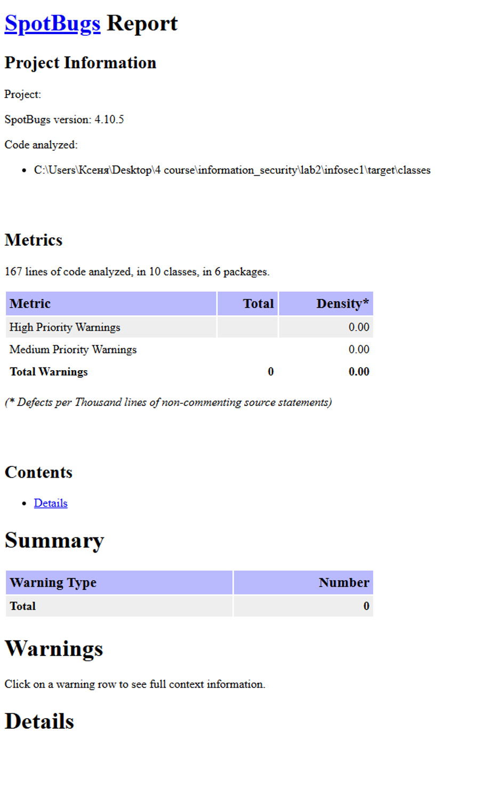
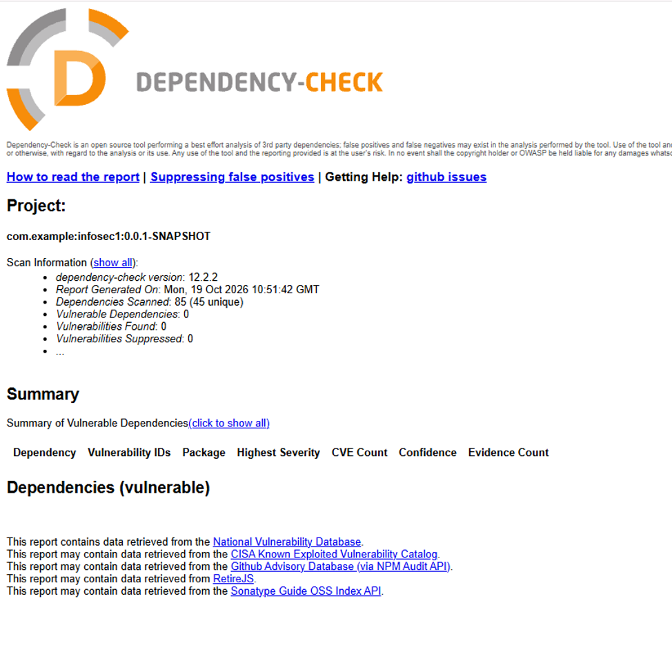

# infosec1 — Защищённый REST API

## Используемые технологии

- Java 21
- Spring Boot 4.0.8
- Spring Security
- Hibernate
- PostgreSQL
- JWT
- BCrypt
- Maven
- SpotBugs
- OWASP Dependency-Check
- GitHub Actions

## API

### 1. POST /auth/register

Регистрация нового пользователя.

Тело запроса:

```json
{
  "username": "testuser",
  "password": "TestPassword123"
}
```

Успешный ответ: 201 Created.

Пароль перед сохранением хешируется алгоритмом BCrypt.

### 2. POST /auth/login

Аутентификация пользователя по логину и паролю.

Тело запроса:

```json
{
  "username": "testuser",
  "password": "TestPassword123"
}
```

Успешный ответ: 200 OK.

В ответе возвращается JWT-токен:

```json
{
  "token": "<JWT_TOKEN>"
}
```

Срок действия токена — 1 час.

При неверных учётных данных возвращается 401 Unauthorized.

### 3. GET /api/data

Получение списка зарегистрированных пользователей.

Для доступа необходимо передать JWT в заголовке запроса:

```http
Authorization: Bearer <JWT_TOKEN>
```

Пример успешного ответа:

```json
{
  "users": ["testuser"]
}
```

Без действительного токена сервер возвращает 401 Unauthorized.

## Реализованные меры безопасности

### Защита от SQL-инъекций

Для работы с PostgreSQL используется Spring Data JPA и Hibernate. Поиск и сохранение пользователей выполняются через репозиторий, без формирования SQL-запросов конкатенацией пользовательского ввода.

### Защита от XSS

Перед возвращением имён пользователей в ответе /api/data применяется HtmlUtils.htmlEscape(), преобразующий специальные HTML-символы.

### Защита аутентификации

- Пароли хранятся в виде BCrypt-хешей.
- Для аутентификации используются подписанные JWT-токены.
- Подпись и срок действия JWT проверяются при обработке запросов.
- Доступ к защищённым эндпоинтам контролируется Spring Security.
- Используется stateless-аутентификация.
- Секрет JWT и пароль базы данных передаются через переменные окружения.

### Результаты SAST — SpotBugs

SpotBugs проанализировал 167 строк кода, 10 классов и 6 пакетов. Всего предупреждений: 0.



### Результаты SCA — OWASP Dependency-Check

В последнем успешном запуске проверено 85 зависимостей. Уязвимых зависимостей: 0. Обнаруженных уязвимостей: 0.


